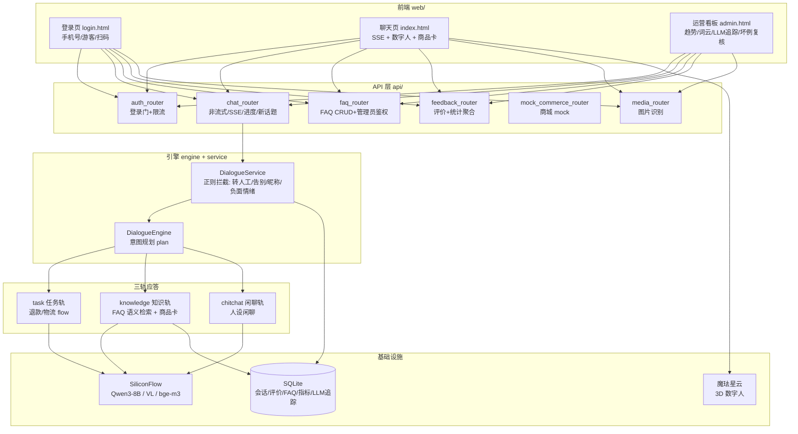

# 电商小二 · 智能客服系统

一个**开箱即用的 AI 电商客服**：多轮任务办理（退款/查物流）、FAQ 知识库、商品导购卡片、图片识别、3D 数字人、运营数据看板，一个项目全部搞定。

   

**在线演示**：https://dianshang-xiaoer-cs-36988.app.workbuddy.host/

---

## ✨ 功能全景（V10）

| # | 功能 | 说明 |
|---|------|------|
| 1 | 🔐 服务端登录门 | 手机号验证码 / 游客 / 扫码三种登录，HttpOnly Cookie + 302 强制跳转，浏览器缓存也绕不过 |
| 2 | 🤖 多轮任务办理 | 退款申请（4 步进度条）、查物流、商品咨询，任务槽位填充 + 会话状态持久化（SQLite） |
| 3 | 📚 FAQ 知识库 | 关键词命中 + **bge-m3 语义向量检索**兜底（相似度 ≥0.50），管理后台在线增删改，改完即时生效 |
| 4 | 🛒 商品导购卡片 | 自然语言搜商品 → 结构化商品卡（价格/库存），点击卡片继续追问 |
| 5 | 👁 图片识别 | 上传截图，Qwen3-VL 识别商品/订单信息并接续处理 |
| 6 | 🧠 会话记忆 | 「叫我土豆」→ 记住昵称；偏好随会话持久化 |
| 7 | ⚡ SSE 流式回复 | 打字机逐字输出，聊天不卡顿 |
| 8 | 📊 运营数据看板 | 点赞点踩趋势、平均响应时长、词云、LLM 调用追踪、坏例复核队列（全部可视化） |
| 9 | 🚦 服务端防刷限流 | 同手机号 60s 冷却 + 同 IP 10 分钟 5 次上限，超限 429 |
| 10 | 💔 情绪检测关怀 | 连续 2 轮负面情绪 → 主动道歉并引导「转人工」 |
| 11 | ❓ 澄清选项气泡 | 意图不明确时返回可点击的选项按钮，一点就发 |
| 12 | 🔍 LLM 调用追踪 | mini-Langfuse：每次 LLM 调用落库（链路/模型/耗时/成败），看板可查 |
| 13 | 🧪 pytest 测试套件 | 15 个用例覆盖登录门/限流/鉴权/FAQ CRUD/聊天快路径（`pytest -q tests`） |
| 14 | 🐳 Docker 一键部署 | `docker compose up -d` 直接跑 |

---

## 🏗 系统架构



---

## 🚀 快速开始

### 方式一：本地运行（uv）

```bash
# 1. 安装依赖（需要 uv：pip install uv）
uv sync

# 2. 配置 .env（项目根目录）
cat > .env << 'EOF'
LLM_API_KEY=sk-你的SiliconFlow密钥
LLM_MODEL=Qwen/Qwen3.8-27B
LLM_BASE_URL=https://api.siliconflow.cn/v1
DATABASE_URL=sqlite+aiosqlite:///customer_service.db
# 单服务版：商城 mock 由本应用自身提供，填本服务地址（端口与下方 APP_PORT 一致）
COMMERCE_API_BASE_URL=http://127.0.0.1:18082
APP_HOST=0.0.0.0
APP_PORT=18082
ADMIN_PASSWORD=改成你的管理密码
EOF

# 3. 启动
uv run python main.py
# 浏览器打开 http://localhost:18082
```

### 方式二：Docker 一键部署（⑧）

```bash
docker compose up -d --build
# 访问 http://localhost:18082
```

### 运行测试

```bash
uv run --with pytest pytest -q tests    # 15 个用例全绿
```

---

## 📡 API 一览

| 方法 | 路径 | 说明 |
|------|------|------|
| GET | `/health` | 健康检查 |
| GET | `/` | 聊天主页（**未登录 302 → /login.html**） |
| POST | `/api/auth/send-code` | 发验证码（60s/号冷却，10min/IP 5 次） |
| POST | `/api/auth/phone-login` | 手机号+验证码登录 |
| POST | `/api/auth/guest` | 游客登录 |
| POST | `/api/auth/logout` | 登出（token 立即失效） |
| POST | `/api/chat` | 非流式对话 |
| GET | `/api/chat/stream` | SSE 流式对话 |
| GET | `/api/chat/progress` | 任务进度（前端步骤条） |
| POST | `/api/chat/new-session` | 开新话题（关闭当前任务） |
| POST | `/api/feedback` | 👍/👎 评价（可带点踩原因） |
| GET | `/api/stats` | 看板聚合（评价/趋势/词云/LLM 追踪/响应时长） |
| GET | `/api/review` · POST | 坏例复核队列（需管理员） |
| GET/POST/PUT/DELETE | `/api/faq[...]` | FAQ CRUD（写操作需 `X-Admin-Token`） |
| POST | `/api/admin/login` | 管理员登录（密码在 .env `ADMIN_PASSWORD`） |
| GET | `/api/mock/products/search` | 商品搜索（mock 商城） |
| POST | `/api/media/recognize` | 图片识别（Qwen3-VL） |

---

## 📁 项目结构

```
电商小二-智能客服/
├── main.py                 # uvicorn 入口
├── api/
│   ├── app.py              # FastAPI 应用 + 登录门 + no-store 中间件 + lifespan
│   ├── schemas.py          # Pydantic 请求/响应模型
│   └── routers/            # auth / chat / faq / feedback / mock_commerce / media
├── service/
│   └── dialogue_service.py # 正则拦截（转人工/告别/昵称/负面情绪）+ 引擎编排
├── engine/                 # DialogueEngine：意图识别 → 轨道分发
├── plan/                   # 意图规划（LLM，含 trace）
├── clarify/                # 澄清追问（含 V10 选项气泡对象）
├── knowledge/              # FAQ 关键词+语义检索、商品搜索 Provider
├── chitchat/               # 闲聊人设
├── task/ + flow_config/    # 退款/物流任务流（槽位填充）
├── domain/state.py         # DialogueState（Pydantic 会话状态）
├── repository/             # 会话状态持久化
├── models/                 # ORM：状态/FAQ/评价/画像/指标/LLM追踪
├── infrastructure/         # database / llm / http_client / trace
├── conf/config.py          # pydantic-settings
├── tests/                  # pytest 套件（15 用例）
├── web/                    # login.html / index.html / admin.html（原生 JS，零构建）
├── Dockerfile              # python:3.12-slim
└── docker-compose.yml      # 数据卷持久化
```

---

## 🎬 5 分钟演示脚本

见 [DEMO.md](./DEMO.md)。

## 🔒 安全说明

- 登录态为 HttpOnly Cookie（8h），JS 无法读取，登出即失效
- 管理密码在服务端 `.env`，前端只持临时 token
- LLM/数据库配置全部走环境变量，不进代码库
